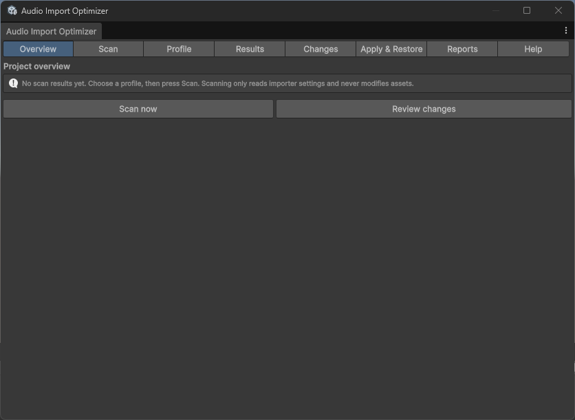
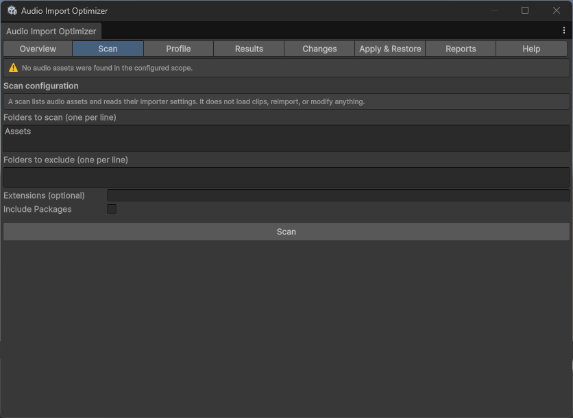
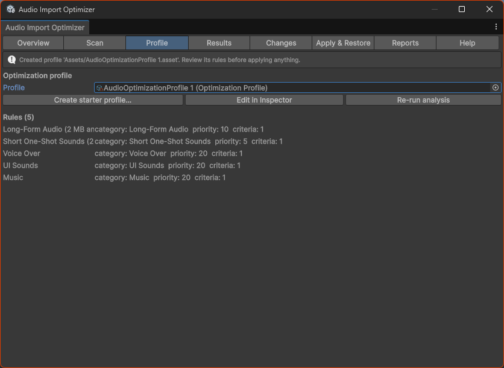
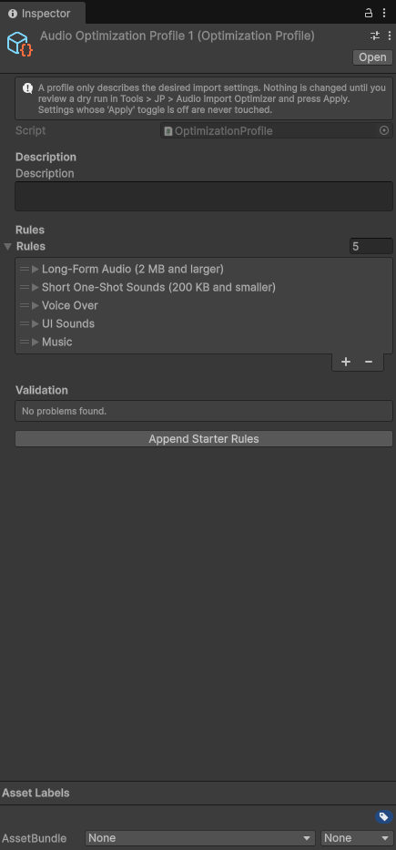
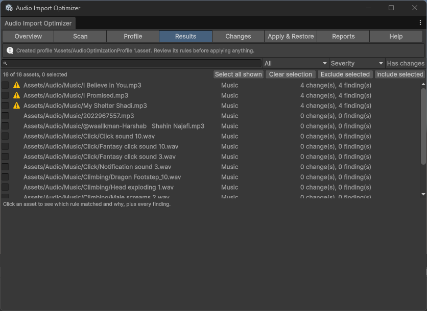
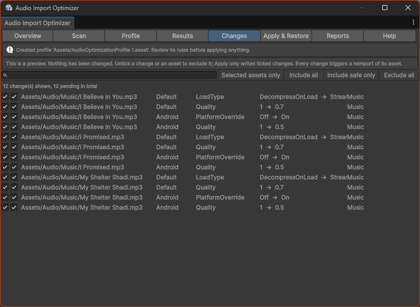
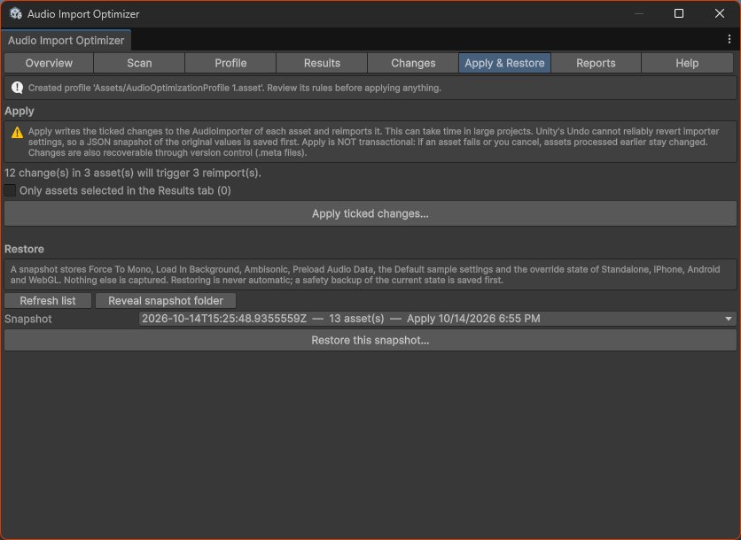
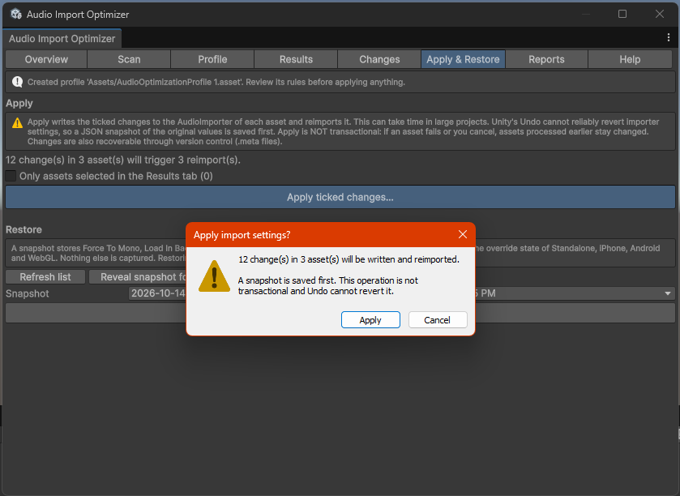

# Audio Import Optimizer

> Unity Editor tool that analyzes audio import settings and applies configurable optimization profiles with dry-run previews and snapshots.

**Status:** 🧪 Preview `0.1.0-preview.1` — compiled and manually tested by the author in Unity 6000.6 (see [Testing](Documentation~/testing.md)). Not submitted to or approved by the Asset Store.

## Why

Audio import settings are easy to get inconsistent across a project (load type, compression, sample rate, mono), which wastes memory and build size. Fixing it by hand is slow and risky.

## Who it is for

Indie developers and small studios shipping to mobile/WebGL/console where audio memory and size matter.

## Features

* Editor window `Tools > JP > Audio Import Optimizer`: overview, scan, profile, results, changes, apply & restore, reports, help
* Read-only, cancellable, time-sliced audio asset scanner (metadata only; no clip loading, no reimport)
* Configurable optimization profiles (`OptimizationProfile` ScriptableObjects) matched by folder, file name pattern, extension, label and file size, with documented precedence and an explanation of why a rule won
* Settings handled: Force To Mono, Load In Background, Ambisonic, Preload Audio Data, Load Type, Compression Format, Quality, Sample Rate Setting, Sample Rate Override
* Platform-specific overrides (Standalone, iPhone, Android, WebGL)
* Validation findings that explain what was detected, why it matters, the proposed change and whether it is safe to auto-apply
* Dry-run previews with per-asset and per-change exclusion; nothing changes until you confirm
* Batch processing with a pre-apply JSON snapshot, no-op detection (no needless reimports), post-apply verification and per-asset results
* Import settings snapshots and recovery (restore with validation)
* Reports: JSON and HTML export
* Fully offline: no telemetry, no network requests

## First milestone (MVP)

Scan a folder, apply one profile with dry-run diff, one-click revert from snapshot, report export. *(Implemented; report formats are JSON and HTML rather than CSV/Markdown.)*

## Compatibility

Tested only with Unity `6000.6`, which is what `package.json` declares. Editor-only, no dependencies, no runtime code. Other Unity versions have not been tested, so they are not claimed.

## Installation

Git URL (once the repository is published): *Window > Package Manager > + > Add package from git URL…*

```
https://github.com/Jolly-Panda-Unity-Pakage/audio-import-optimizer.git
```

Or copy the repository folder into your project's `Packages/` folder, or use *Add package from disk…* and select `package.json`. Details: [Getting started](Documentation~/getting-started.md).

## Quick start

1. `Tools > JP > Audio Import Optimizer` → **Profile** → *Create starter profile…* (edit the folders to fit your project).
2. **Scan** → *Scan*.
3. Review **Results** and **Changes** (the dry run).
4. **Apply & Restore** → *Apply ticked changes…*; restore from a snapshot if needed.

## Screenshots

Captured in Unity 6000.6.

| | |
|---|---|
|  |  |
|  |  |
|  |  |
|  |  |

## Documentation

[Index](Documentation~/index.md) · [Getting started](Documentation~/getting-started.md) · [User guide](Documentation~/user-guide.md) · [Profiles](Documentation~/optimization-profiles.md) · [Troubleshooting](Documentation~/troubleshooting.md) · [Architecture](Documentation~/architecture.md) · [API](Documentation~/api-reference.md) · [Testing](Documentation~/testing.md) · [Test and publish guide](Documentation~/testing-and-publishing.md) · [Publication checklist](Documentation~/publication-checklist.md)

## Testing

Manually tested by the author in Unity 6000.6: the package compiles, and the window, profile creation, scan, results, dry run, apply (3 assets, 12 changes, 0 failures) and snapshot creation work (screenshots above). EditMode tests are in `Tests/EditMode`; the pure-logic part also ran outside Unity through a stub runner, but a Unity Test Runner result has **not** been recorded yet. Details: [testing.md](Documentation~/testing.md).

## Known limitations

* Apply is not transactional; Undo cannot revert importer settings (use snapshots / version control)
* Normalize is not supported (no verified public importer property)
* Only Standalone, iPhone, Android and WebGL overrides are inspected
* File size, not clip duration, is used for size rules; no memory or build-size savings are estimated
* Snapshots capture only the settings listed above

## Author

Usef Farahmand — https://useffarahmand.com — contact@useffarahmand.com. © 2026 Usef Farahmand. Licensed under the [MIT License](LICENSE.md).

---

Part of [Jolly Panda Unity Packages](https://github.com/Jolly-Panda-Unity-Pakage). Documentation is provided in English.
